# Target Data Dictionary and ERD — Enterprise Database Redesign

**Repository:** `alaa5366/BuildingManagement-MVC`  
**Branch:** `development/database-redesign-enterprise`  
**Status:** Proposed logical/physical design for review. Not production DDL.  
**Prerequisite:** Confirm actual SQL column types and lengths from the complete live inventory before generating EF Core entities or migrations.

## 1. Design conventions

### 1.1 Key strategy

- New independent entity identifiers are proposed as SQL Server `uniqueidentifier`, generated by the application or database according to one consistent policy.
- Existing `Buildings.Id` and `Apartments.(BuildingId, Id)` identifiers remain unchanged during the identity migration.
- Any FK to a legacy key must use the exact SQL type, length, collation, and nullability of the referenced key. The current inventory indicates key-length differences between the live database and some EF configurations; do not copy a guessed `nvarchar(64)` declaration into migrations.
- Where an entity is building-scoped, retain `BuildingId` in the row and use composite FKs to enforce same-building integrity.
- Use UTC `datetime2(3)` for instants. Use `date` only for genuinely date-only business concepts.
- Use `decimal(9,6)` for ownership percentages (0–100) as a proposal; money precision remains whatever the existing financial model currently uses.
- Use `nvarchar` with explicit bounded lengths for human-entered text. Do not use `nvarchar(max)` for indexed keys or short codes.
- All proposed status values must be defined centrally and validated; avoid free-form status strings.

### 1.2 Shared audit columns

For mutable target entities, consider:
- `CreatedAtUtc datetime2(3) NOT NULL`
- `CreatedByAccountId uniqueidentifier NULL`
- `UpdatedAtUtc datetime2(3) NULL`
- `UpdatedByAccountId uniqueidentifier NULL`
- `RowVersion rowversion` where concurrent edits are possible.

For temporal relationship records, also store `ValidFromUtc` and nullable `ValidToUtc`. These are business-effective times, distinct from record creation/update times.

### 1.3 Delete policy

- Default FK behavior: `NO ACTION` / restrictive.
- Use soft archive, close-out, revoke, void, or reversal instead of deleting referenced business history.
- Cascade is permitted only for disposable child data whose lifecycle is strictly owned by the parent and whose deletion cannot erase evidence, finance, or audit history.
- Polls and options become immutable after voting opens; retain ballots and results.

## 2. Target data dictionary

The lengths below are proposed domain limits, not a claim about existing live column lengths. They must be checked against UI validation, integrations, actual data, SQL Server index limits, and existing key definitions before implementation.

### 2.1 Identity and credentials

#### Persons

| Column | Proposed SQL type | Null | Rule / purpose |
|---|---|---:|---|
| PersonId | uniqueidentifier | No | PK |
| LegalName | nvarchar(200) | Yes | Legal name, if collected |
| DisplayName | nvarchar(160) | No | Display name |
| PrimaryEmail | nvarchar(254) | Yes | Contact only; not automatically unique |
| PrimaryPhone | nvarchar(32) | Yes | Normalized E.164 where possible; not automatically unique |
| Whatsapp | nvarchar(32) | Yes | Optional contact |
| PhotoUrl | nvarchar(2048) | Yes | URL/reference only |
| IsArchived | bit | No | Default 0 |
| ArchivedAtUtc | datetime2(3) | Yes | Must align with archive state |
| CreatedAtUtc / UpdatedAtUtc | datetime2(3) | No/Yes | Audit timestamps |
| RowVersion | rowversion | No | Optimistic concurrency |

Indexes: PK(PersonId); optional non-unique normalized email/phone indexes for lookup. Do not enforce global uniqueness until the product confirms that shared contacts are forbidden.

#### UserAccounts

| Column | Proposed SQL type | Null | Rule / purpose |
|---|---|---:|---|
| AccountId | uniqueidentifier | No | PK |
| PersonId | uniqueidentifier | No | FK Persons; unique (one human account per person) |
| AccountStatus | tinyint | No | 0 Pending, 1 Active, 2 Locked, 3 Disabled |
| NormalizedEmail | nvarchar(254) | Yes | Unique filtered index only if email is the login identifier and duplicates are prohibited |
| ExternalProvider | nvarchar(40) | Yes | Provider key |
| ExternalSubject | nvarchar(200) | Yes | Provider subject; unique with provider when populated |
| SecurityStamp | nvarchar(128) | No | Random security/concurrency token |
| LastLoginAtUtc | datetime2(3) | Yes | Last successful login |
| CreatedAtUtc | datetime2(3) | No | Creation |
| RowVersion | rowversion | No | Concurrency |

Constraints: UNIQUE(PersonId); FK PersonId → Persons with NO ACTION. Do not create a second account to represent SuperAdmin; it is a scoped role assignment.

#### UserCredentials

| Column | Proposed SQL type | Null | Rule / purpose |
|---|---|---:|---|
| CredentialId | uniqueidentifier | No | PK |
| AccountId | uniqueidentifier | No | FK UserAccounts |
| CredentialType | tinyint | No | 0 Password, 1 PIN; external provider subject is account-level, not a password-hash credential |
| CredentialHash | nvarchar(512) | No | Encoded password-hash output; never plaintext |
| HashAlgorithm | nvarchar(40) | No | Versioned algorithm identifier |
| CreatedAtUtc | datetime2(3) | No | Enrollment time |
| ExpiresAtUtc | datetime2(3) | Yes | Optional expiry |
| RevokedAtUtc | datetime2(3) | Yes | Revocation |
| ReplacedByCredentialId | uniqueidentifier | Yes | Optional self-reference |

Indexes: AccountId + CredentialType + active-state lookup. Permit multiple credential history rows; enforce at most one active credential per account/type with a filtered unique index if that is the chosen policy.

#### UserTwoFactorSettings

| Column | Proposed SQL type | Null | Rule / purpose |
|---|---|---:|---|
| AccountId | uniqueidentifier | No | PK and FK UserAccounts |
| IsEnabled | bit | No | Default 0; disabling clears the active secret |
| SecretCiphertext | varbinary(max) | Yes | Authenticator secret encrypted with managed key |
| KeyVersion | nvarchar(64) | Yes | Key identifier/version |
| *(no recovery-code payload column)* | — | — | Recovery codes are stored only in the normalized `UserRecoveryCodes` child table; do not duplicate them as JSON on this row |
| LastAcceptedTimeStep | bigint | Yes | Replay prevention |
| EnrolledAtUtc | datetime2(3) | Yes | Enrollment |
| LastVerifiedAtUtc | datetime2(3) | Yes | Last successful verification |
| UpdatedAtUtc | datetime2(3) | Yes | Update |

Implementation note: An enabled row requires ciphertext, key version, and enrollment timestamp. A disabled row has no active ciphertext/key version. Prefer the separate `UserRecoveryCodes` table with one row per hashed code and atomic one-time consumption. Never return ciphertext, raw secrets, or recovery codes to browser DTOs. Existing encrypted 2FA values must be migrated only after validating key availability and encryption format.

#### UserRecoveryCodes

| Column | Proposed SQL type | Null | Rule / purpose |
|---|---|---:|---|
| RecoveryCodeId | uniqueidentifier | No | PK |
| AccountId | uniqueidentifier | No | FK UserAccounts |
| CodeHash | varbinary(64) | No | One-way hash of high-entropy code |
| CreatedAtUtc | datetime2(3) | No | Creation |
| UsedAtUtc | datetime2(3) | Yes | One-time consumption |

Unique index on CodeHash; filtered index for unused codes by AccountId.

### 2.2 Apartment relationships

#### ApartmentOwnerships

| Column | Proposed SQL type | Null | Rule / purpose |
|---|---|---:|---|
| OwnershipId | uniqueidentifier | No | PK |
| BuildingId | legacy key type | No | Composite FK to Apartments |
| ApartmentId | legacy key type | No | Composite FK to Apartments |
| PersonId | uniqueidentifier | No | FK Persons |
| OwnershipSharePercent | decimal(9,6) | No | CHECK 0 < share ≤ 100 |
| ValidFromUtc | datetime2(3) | No | Effective start |
| ValidToUtc | datetime2(3) | Yes | Exclusive end; must be later than start |
| RecordedAtUtc | datetime2(3) | No | Audit |
| RecordedByAccountId | uniqueidentifier | Yes | Actor |
| EvidenceReference | nvarchar(500) | Yes | Document/reference; not document secret |
| Notes | nvarchar(1000) | Yes | Administrative note |
| RowVersion | rowversion | No | Concurrency |

Indexes: (BuildingId, ApartmentId, ValidFromUtc, ValidToUtc); (PersonId, ValidFromUtc, ValidToUtc). Prevent duplicate overlapping rows for the same person/apartment in service/domain validation; SQL Server cannot express general interval-overlap exclusion with a simple unique index. Enforce share-total rules transactionally for each effective date. Do not require exactly 100% for records explicitly marked incomplete; if that distinction is needed, add a reviewed ownership-completeness state at the apartment/effective-period level.

#### ApartmentOccupancies

| Column | Proposed SQL type | Null | Rule / purpose |
|---|---|---:|---|
| OccupancyId | uniqueidentifier | No | PK |
| BuildingId | legacy key type | No | Composite FK to Apartments |
| ApartmentId | legacy key type | No | Composite FK to Apartments |
| PersonId | uniqueidentifier | No | FK Persons |
| OccupancyType | tinyint | No | OwnerOccupant, Tenant, Family, Other |
| IsPrimary | bit | No | Default 0 |
| ValidFromUtc | datetime2(3) | No | Effective start |
| ValidToUtc | datetime2(3) | Yes | Exclusive end |
| RecordedAtUtc | datetime2(3) | No | Audit |
| RecordedByAccountId | uniqueidentifier | Yes | Actor |
| Notes | nvarchar(1000) | Yes | Optional |
| RowVersion | rowversion | No | Concurrency |

Indexes: apartment + effective dates; person + effective dates. A filtered unique index on (BuildingId, ApartmentId) WHERE IsPrimary=1 AND ValidToUtc IS NULL guarantees only one currently open primary row, but it does not prevent historical interval overlap; the service must validate all interval transitions transactionally.

#### ApartmentAccessGrants

| Column | Proposed SQL type | Null | Rule / purpose |
|---|---|---:|---|
| GrantId | uniqueidentifier | No | PK |
| BuildingId | legacy key type | No | Composite FK to Apartments |
| ApartmentId | legacy key type | No | Composite FK to Apartments |
| PersonId | uniqueidentifier | No | FK Persons |
| GrantType | tinyint | No | Controlled grant type |
| PermissionSetKey | nvarchar(80) | No | Versioned permission profile |
| ValidFromUtc | datetime2(3) | No | Start |
| ValidToUtc | datetime2(3) | Yes | Expiry |
| GrantedAtUtc | datetime2(3) | No | Record/command timestamp |
| GrantedByAccountId | uniqueidentifier | No | Granting actor |
| RevokedAtUtc | datetime2(3) | Yes | Revocation |
| RevokedByAccountId | uniqueidentifier | Yes | Revoking actor |
| Reason | nvarchar(500) | Yes | Grant/revocation reason |

No grant itself creates ownership, occupancy, or a login account.

### 2.3 Scoped authorization

#### RoleDefinitions

| Column | Proposed SQL type | Null | Rule / purpose |
|---|---|---:|---|
| RoleKey | nvarchar(64) | No | PK stable key |
| DisplayName | nvarchar(120) | No | Localizable label key/name |
| IsSystemRole | bit | No | System-controlled role |
| IsActive | bit | No | Default 1 |

#### RolePermissions

| Column | Proposed SQL type | Null | Rule / purpose |
|---|---|---:|---|
| RoleKey | nvarchar(64) | No | PK part / FK RoleDefinitions |
| PermissionKey | nvarchar(100) | No | PK part |
| Effect | tinyint | No | Allow/Deny; deny precedence must be documented |

PK(RoleKey, PermissionKey). Permission catalog must be code-owned/versioned or separately normalized; do not accept arbitrary permission strings from clients.

#### UserRoleAssignments

| Column | Proposed SQL type | Null | Rule / purpose |
|---|---|---:|---|
| RoleAssignmentId | uniqueidentifier | No | PK |
| AccountId | uniqueidentifier | No | FK UserAccounts |
| RoleKey | nvarchar(64) | No | FK RoleDefinitions |
| ScopeType | tinyint | No | System, Building, Apartment, Personal |
| ScopeBuildingId | legacy key type | Yes | Required for Building/Apartment |
| ScopeApartmentId | legacy key type | Yes | Required only for Apartment |
| ValidFromUtc | datetime2(3) | No | Start |
| ValidToUtc | datetime2(3) | Yes | End |
| GrantedAtUtc | datetime2(3) | No | Record/command timestamp |
| GrantedByAccountId | uniqueidentifier | Yes | Actor |
| GrantReason | nvarchar(500) | Yes | Grant rationale |
| RevokedAtUtc | datetime2(3) | Yes | Revocation |
| RevokedByAccountId | uniqueidentifier | Yes | Actor |
| RevocationReason | nvarchar(500) | Yes | Revocation rationale |
| RowVersion | rowversion | No | Concurrency |

Scope validity rules:
- System: both scope IDs NULL.
- Building: BuildingId NOT NULL, ApartmentId NULL.
- Apartment: both IDs NOT NULL and the apartment must belong to that building.
- Personal: both scope IDs NULL, with authorization limited to the subject's own PersonId in the service.
- A normalized scope table may replace nullable scope columns if strict FK enforcement for each scope is preferred.
- Add filtered unique indexes only after role-overlap and assignment renewal semantics are decided. Prevent duplicate active assignments in the service under transaction/serializable locking.

### 2.4 Polling, eligibility, delegation, and secret ballots

#### PollVotingPolicies

| Column | Proposed SQL type | Null | Rule / purpose |
|---|---|---:|---|
| PollId | legacy poll key type | No | PK/FK to Polls |
| VotingMode | tinyint | No | Person or Apartment |
| IsSecret | bit | No | Required by approved policy |
| AllowDelegation | bit | No | Must be true for apartment mode if delegated representative is required |
| EligibilityPolicyKey | nvarchar(80) | No | Versioned rule |
| OpensAtUtc | datetime2(3) | Yes | Opening |
| ClosesAtUtc | datetime2(3) | Yes | Closing |
| PolicySnapshot | nvarchar(max) | No | Versioned JSON; schema validated and immutable after open |
| FrozenAtUtc | datetime2(3) | Yes | Policy lock time |

The actual PollId type must match the current composite poll key. Do not create a cross-type FK.

#### PollDelegations

| Column | Proposed SQL type | Null | Rule / purpose |
|---|---|---:|---|
| DelegationId | uniqueidentifier | No | PK |
| PollId | legacy poll key type | No | FK poll |
| BuildingId | legacy key type | No | Same-building scope |
| ApartmentId | legacy key type | No | Composite FK apartment |
| DelegatingPersonId | uniqueidentifier | No | Person authorizing |
| RepresentativePersonId | uniqueidentifier | No | Person representing |
| ValidFromUtc | datetime2(3) | No | Start |
| ValidToUtc | datetime2(3) | Yes | End |
| CreatedAtUtc | datetime2(3) | No | Audit |
| RevokedAtUtc | datetime2(3) | Yes | Revocation |
| EvidenceReference | nvarchar(500) | Yes | Consent evidence |

Delegation policy must decide whether all co-owners must consent, whether a tenant may delegate, and whether one representative may represent multiple apartments in the same poll. Enforce policy at poll opening and vote submission, not only in UI.

#### PollEligibility

| Column | Proposed SQL type | Null | Rule / purpose |
|---|---|---:|---|
| EligibilityId | uniqueidentifier | No | PK; opaque random ID |
| PollId | legacy poll key type | No | FK poll |
| SubjectType | tinyint | No | Person or Apartment |
| PersonId | uniqueidentifier | Yes | Eligibility subject for person mode |
| BuildingId | legacy key type | Yes | Required for apartment subject |
| ApartmentId | legacy key type | Yes | Required for apartment subject |
| DelegationId | uniqueidentifier | Yes | Evidence for apartment representative |
| CredentialHash | varbinary(32) | No | Hash of one-time high-entropy vote credential |
| State | tinyint | No | Issued, Consumed, Revoked, Expired |
| IssuedAtUtc | datetime2(3) | No | Issue time |
| ConsumedAtUtc | datetime2(3) | Yes | Participation time |
| ExpiresAtUtc | datetime2(3) | No | Credential expiry |

Use CHECK constraints for the legal SubjectType/PersonId/ApartmentId combination. Unique index on (PollId, PersonId) for person-mode eligibility where PersonId is not NULL; unique index on (PollId, BuildingId, ApartmentId) for apartment-mode eligibility where ApartmentId is not NULL. CredentialHash unique. Eligibility is identity/participation data and must never contain OptionId or ballot choice.

#### PollBallots

| Column | Proposed SQL type | Null | Rule / purpose |
|---|---|---:|---|
| BallotId | uniqueidentifier | No | Random PK |
| PollId | legacy poll key type | No | FK poll |
| OptionId | legacy option key type | No | FK option, type exact |
| CastAtUtc | datetime2(3) | No | Minimize precision/metadata where possible |

**Prohibited columns:** PersonId, AccountId, ApartmentId, EligibilityId, DelegationId, CredentialHash, voter token, IP address, device fingerprint, or any identity-to-ballot correlation key.

The vote flow validates and atomically consumes the eligibility credential, then writes the ballot through a separate repository/service boundary. It must not persist a mapping between EligibilityId/CredentialHash and BallotId. Use least-privilege DB permissions so the eligibility reader cannot query ballot choices and ballot writer cannot read eligibility identity. Avoid logging ballot IDs, credentials, choice payloads, and precise identity-correlatable timestamps.

This relational separation reduces direct linkability; it is not a cryptographic guarantee against privileged correlation of timing, transaction logs, backups, or network metadata. High-assurance secret elections require a separately designed and independently assessed cryptographic protocol.

#### PollLifecycleEvents

| Column | Proposed SQL type | Null | Rule / purpose |
|---|---|---:|---|
| PollLifecycleEventId | uniqueidentifier | No | PK |
| PollId | legacy poll key type | No | FK poll |
| EventType | tinyint | No | Created, Opened, Closed, Archived |
| OccurredAtUtc | datetime2(3) | No | Event time |
| ActorAccountId | uniqueidentifier | Yes | Actor snapshot/reference |
| DetailsRedacted | nvarchar(1000) | Yes | No voter choice/secret |

Polls/options cannot be physically deleted after opening or after ballots exist. Historical legacy PollVotes remain explicitly marked as apartment-attributed legacy votes; they must not be represented as anonymous ballots.

### 2.5 Settings and secrets

#### ProtectedIntegrationSecrets

| Column | Proposed SQL type | Null | Rule / purpose |
|---|---|---:|---|
| SecretId | uniqueidentifier | No | PK |
| ScopeType | tinyint | No | System or Building |
| BuildingId | legacy key type | Yes | Building scope FK |
| ProviderKey | nvarchar(80) | No | e.g. WhatsApp, Cloudinary |
| SecretName | nvarchar(100) | No | Stable key |
| Ciphertext | varbinary(max) | No | Authenticated encryption |
| KeyVersion | nvarchar(64) | No | External key version |
| Nonce | varbinary(32) | No | Algorithm-specific nonce |
| AuthTag | varbinary(32) | No | Algorithm-specific tag |
| UpdatedAtUtc | datetime2(3) | No | Rotation time |
| UpdatedByAccountId | uniqueidentifier | Yes | Actor |

Unique key on (ScopeType, BuildingId, ProviderKey, SecretName) with correct handling for system-scoped NULL BuildingId. Encryption key material must be external to SQL Server. UI may receive only configured state, last-updated metadata, and safe masked hints where approved. Never return ciphertext or decrypted secret.

### 2.6 LegacyIdentityMap — migration provenance

| Column | Proposed SQL type | Null | Rule / purpose |
|---|---|---:|---|
| LegacyIdentityMapId | uniqueidentifier | No | PK |
| SourceSystem | nvarchar(80) | No | Stable source-system key |
| SourceTable | nvarchar(128) | No | Initial allow-list: Users, Residents |
| SourceKey | nvarchar(256) | No | Exact serialized source-row key; never a secret |
| PersonId | uniqueidentifier | Yes | FK Persons; many Residents rows may map to one Person |
| AccountId | uniqueidentifier | Yes | FK UserAccounts; only Users source rows may populate it |
| MappingStatus | tinyint | No | 0 Pending, 1 Linked, 2 Separate, 3 Rejected, 4 ManualReview |
| MatchMethod | nvarchar(80) | Yes | Exact UID candidate, manual review, etc. |
| EvidenceReference | nvarchar(500) | Yes | Restricted evidence reference, not raw PII |
| ReviewReason | nvarchar(1000) | Yes | Safe, non-secret rationale |
| ReviewedAtUtc / ReviewedByAccountId | datetime2(3) / uniqueidentifier | Yes | Review audit |
| CreatedAtUtc / UpdatedAtUtc | datetime2(3) | No / Yes | Record audit |
| RowVersion | rowversion | No | Concurrency |

Constraints and indexes:
- Unique `(SourceSystem, SourceTable, SourceKey)`.
- Filtered unique index on non-null AccountId: a legacy Users row cannot be mapped to the same target account as another Users row.
- Filtered indexes on PersonId and AccountId, plus status/source lookup.
- Restrictive FKs to Persons and UserAccounts; no cascade delete.
- Residents rows may map many-to-one to Person, but do not directly carry AccountId. The account is reached through the reviewed Person-to-UserAccount relation.
- A Users row in Linked or Separate disposition requires both PersonId and AccountId; Pending, Rejected, and ManualReview rows must have neither target populated. The migration service must verify transactionally that the AccountId belongs to the same PersonId; this pair is not inferred from two independent FKs. Review timestamp and reviewer are required together.
- Pending, Rejected, and ManualReview rows may remain unresolved. Never fabricate a target just to complete the migration.
- Initial source allow-list is deliberately limited to Users and Residents. Expand only with a separately reviewed mapping.

Do not store plaintext credentials, hashes, PINs, raw contact details, or unnecessary personal values in this ledger. Restrict read access to migration operators.
 
### 2.7 Existing tables intentionally retained in first rollout

No redesign/rekey is proposed in the identity migration for:
- Buildings, Floors, Apartments
- Deposits, DepositEditHistory, Expenses, Revenues, FinancialCategories
- MonthlyApartmentShares, WalletAdjustments
- Notifications, AuditLog, MaintenanceRecords
- QrTokens, QrUsages, Presence
- Dvrs, Cameras
- BackupHistory, ScheduledBackupSettings
- Polls, PollOptions (with lifecycle changes)
- Existing Users, Residents, BuildingAdmins, UserPermissions as compatibility sources until cutover

The apartment wallet remains apartment-scoped. Existing money precision, posting rules, and historic balances must not change in this migration.

## 3. Entity relationship diagram

The ERD below is conceptual. Legacy key types are deliberately labelled rather than guessed. Dashed/annotated relationships are enforced by application policy or a later normalized scope table.

```mermaid
erDiagram
    PERSONS ||--o| USER_ACCOUNTS : "has at most one"
    USER_ACCOUNTS ||--o{ USER_CREDENTIALS : "credential history"
    USER_ACCOUNTS ||--o| USER_TWO_FACTOR_SETTINGS : "MFA"
    USER_ACCOUNTS ||--o{ USER_RECOVERY_CODES : "recovery"
    PERSONS ||--o{ APARTMENT_OWNERSHIPS : "owns over time"
    PERSONS ||--o{ APARTMENT_OCCUPANCIES : "occupies over time"
    PERSONS ||--o{ APARTMENT_ACCESS_GRANTS : "receives access"
    USER_ACCOUNTS ||--o{ USER_ROLE_ASSIGNMENTS : "has scoped roles"
    USER_ACCOUNTS ||--o{ ACCOUNT_PERMISSION_OVERRIDES : "direct scoped overrides"
    ROLE_DEFINITIONS ||--o{ USER_ROLE_ASSIGNMENTS : "assigned"
    ROLE_DEFINITIONS ||--o{ ROLE_PERMISSIONS : "contains"
    POLLS ||--o| POLL_VOTING_POLICIES : "policy"
    POLLS ||--o{ POLL_DELEGATIONS : "delegation"
    POLLS ||--o{ POLL_ELIGIBILITY : "eligible subjects"
    POLLS ||--o{ POLL_BALLOTS : "anonymous choices"
    POLL_OPTIONS ||--o{ POLL_BALLOTS : "selected option"
    POLLS ||--o{ POLL_LIFECYCLE_EVENTS : "lifecycle"
    PERSONS ||--o{ POLL_DELEGATIONS : "delegator or representative"
    POLL_DELEGATIONS ||--o{ POLL_ELIGIBILITY : "eligibility evidence"
    USER_ACCOUNTS ||--o{ PROTECTED_INTEGRATION_SECRETS : "updates"
    PERSONS ||--o{ LEGACY_IDENTITY_MAP : "legacy source mapping"
    USER_ACCOUNTS ||--o{ LEGACY_IDENTITY_MAP : "legacy account mapping"

    APARTMENTS ||--o{ APARTMENT_OWNERSHIPS : "ownership history"
    APARTMENTS ||--o{ APARTMENT_OCCUPANCIES : "occupancy history"
    APARTMENTS ||--o{ APARTMENT_ACCESS_GRANTS : "access grants"
    APARTMENTS ||--o{ POLL_DELEGATIONS : "apartment delegation"
    APARTMENTS ||--o{ POLL_ELIGIBILITY : "apartment eligibility"
    BUILDINGS ||--o{ APARTMENTS : "contains"
    BUILDINGS ||--o{ USER_ROLE_ASSIGNMENTS : "building scope"
```

Important: The ERD intentionally has no relationship from `POLL_ELIGIBILITY` to `POLL_BALLOTS`. That missing edge is a security requirement, not an omission.

## 4. SQL Server constraints and index plan

Before implementation, validate and add as appropriate:

1. PK and FK constraints for every entity relationship.
2. CHECK constraints:
   - ownership percentage > 0 and <= 100;
   - ValidToUtc IS NULL OR ValidToUtc > ValidFromUtc;
   - valid scope combinations;
   - valid voting subject combinations;
   - valid status ranges where numeric status codes are used.
3. Filtered unique index for one current primary occupant per apartment.
4. Unique account per Person.
5. Unique external provider + subject when both are populated.
6. Unique vote credential hash.
7. Unique eligibility subject per poll and voting mode.
8. Indexes for building/apartment + effective date and account + active role scope.
9. Composite FKs to prevent cross-building Apartment/Floor, Camera/DVR, and other tenant-scope mismatches.
10. NO ACTION delete behavior for finance, audit, ownership, occupancy, ballots, and migration evidence.

Interval overlap and aggregate share-total rules require transactional domain validation; simple row CHECK constraints are insufficient.

## 5. Required product decisions before physical DDL

The architecture document lists the decisions in detail. The following must be confirmed:

| Decision | Proposed default | Must be confirmed |
|---|---|---|
| Ownership total | 100% when ownership is declared complete; allow explicit incomplete state | Yes |
| Apartment poll eligibility | Configurable policy; explicitly define owner/occupant/tenant rights | Yes |
| Multiple apartment delegations to one representative | Allow if each delegation is valid and policy permits | Yes |
| Apartment vs person preferences | Person-specific preference with apartment default | Yes |
| Legacy plaintext PIN | Force secure reset/re-enrollment; never copy plaintext | Yes |
| Historical deletion/retention | Archive/revoke/void; retain finance/audit/poll evidence | Yes |
| Secret ballot assurance | Operational database separation by default; independent cryptographic design if certification/high assurance is required | Yes |

## 6. Implementation gates

No EF Core entity or migration changes should be made until all gates pass:

- [ ] Full live column metadata export is reviewed and attached to the redesign record.
- [ ] All existing key types/lengths/collations are reconciled against EF model and migrations.
- [ ] The live wallet view definition and dependencies are confirmed.
- [ ] Existing 2FA encryption key and payload format are verified with a recoverability test.
- [ ] Ownership, occupancy, delegation, and notification rules are approved.
- [ ] Duplicate/ambiguous person matching report is reviewed; no automatic name/phone merge.
- [ ] Existing finance counts and balances are baselined.
- [ ] Poll legacy vote preservation approach is approved.
- [ ] Exact FK delete actions and indexes are reviewed for every affected table.
- [ ] Additive migration and restartable backfill plan is reviewed on a disposable restored database.

## 7. Next artifact

After the product decisions and metadata gates are confirmed, create:
1. Read-only profiling SQL for duplicates, ownership candidates, primary occupancy, poll consistency, finance reconciliation, camera/DVR scope, and secret inventory (without printing secret values).
2. A source-to-target field mapping matrix with confidence level and manual-review cases.
3. EF Core entity/configuration implementation plan, followed by additive migrations on a disposable restore only.

**No database has been modified by this document.**

### 2.8 AccountPermissionOverrides

This table preserves the semantics of legacy `UserPermissions(Uid, Permission)`, which is account-specific and cannot be safely converted into role-wide `RolePermissions`.

| Column | Proposed SQL type | Null | Rule / purpose |
|---|---|---:|---|
| OverrideId | uniqueidentifier | No | PK |
| AccountId | uniqueidentifier | No | FK UserAccounts |
| PermissionKey | nvarchar(100) | No | Code-owned permission catalog key |
| Effect | tinyint | No | 0 Deny, 1 Allow; deny precedence |
| ScopeType | tinyint | No | System, Building, Apartment, Personal |
| ScopeBuildingId | legacy key type | Yes | Required for Building/Apartment |
| ScopeApartmentId | legacy key type | Yes | Required only for Apartment |
| ValidFromUtc | datetime2(3) | No | Effective start |
| ValidToUtc | datetime2(3) | Yes | Exclusive end |
| GrantedAtUtc | datetime2(3) | No | Audit timestamp |
| GrantedByAccountId | uniqueidentifier | Yes | Granting actor |
| GrantReason | nvarchar(500) | Yes | Grant rationale |
| RevokedAtUtc | datetime2(3) | Yes | Revocation timestamp |
| RevokedByAccountId | uniqueidentifier | Yes | Revoking actor |
| RevocationReason | nvarchar(500) | Yes | Revocation rationale |
| RowVersion | rowversion | No | Concurrency |

Scope combinations must match `UserRoleAssignments`. Restrictive FKs enforce account, building, and apartment scope. The service must evaluate permission overrides with explicit scope and validity; deny takes precedence. Do not create role-wide permissions from account-specific legacy rows. Interval overlap and duplicate active grants are transactionally validated.

### 2.9 Gate A provenance table alignment

The physical additive Gate A script now creates `dbo.LegacyIdentityMap` as described in section 2.6. It replaces the earlier conceptual `IdentityMigrationMap` naming. The preflight object inventory now expects thirteen Gate A tables. This remains proposed DDL only; no execution or EF migration is authorized.
